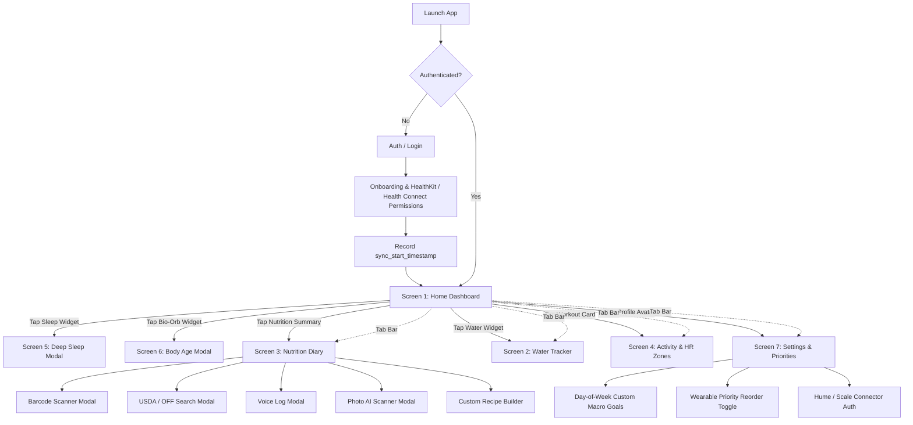

# HumanAudit — App Flow & Navigation Architecture

## 1. Directory & Routing Structure (Expo Router ~57)

> Status: the tree below is the implemented layout plus planned screens. Items marked **(not built)** are planned only. There is no local SQLite store; the app reads and writes through the Next.js API.

```
app/
├── _layout.tsx                     # Global Providers (Clerk, Theme, Biometric lock)
├── onboarding.tsx                  # Biometrics, Login Date Baseline & Permissions
├── auth/
│   ├── _layout.tsx
│   ├── login.tsx                   # Clerk sign-in
│   └── register.tsx                # Clerk sign-up
├── (tabs)/
│   ├── _layout.tsx                 # Custom Mellow Bottom Tab Bar (5 Tabs)
│   ├── index.tsx                   # [Screen 1] Home Dashboard (Central Hub)
│   ├── water.tsx                   # [Screen 2] Hydration Hub (Waterlogged)
│   ├── diary.tsx                   # [Screen 3] Food Diary (Today Only)
│   ├── activity.tsx                # [Screen 4] Workouts & HR Zones (1-5)
│   └── settings.tsx                # [Screen 7] Settings, Deduplication & Connectors
(no routed modals)                  # Modals are components in components/:
                                    #   BarcodeScannerModal, PhotoMealModal, VoiceLogModal,
                                    #   CustomFoodModal, RecipeBuilderModal
                                    # Food search (Open Food Facts primary, USDA fallback) and
                                    # macro goals live inside diary.tsx / settings.tsx.
(not built) sleep-detail            # [Screen 5] Sleep Hypnogram & Vitals
(not built) body-age-detail         # [Screen 6] Bio-Orb & Trajectory
```

---

## 2. Navigation State Map & Transitions



---

## 3. Screen-by-Screen State Interactions

### 3.1 Screen 1: Home Dashboard (`/index`)
* **State Ingested:** Today's Readiness (%), Day Strain (0–21), Today's Consumed vs Target Macros (P/C/F), Water Intake (ml), Synced Scale Weight (kg), and Latest Workout HR Zone Summary.
* **Micro-Interactions:**
  * Pull-to-refresh initiates health bridge sync.
  * Tapping any summary card performs a fluid shared-element transition to its respective detail modal.

### 3.2 Screen 2: Hydration Hub (`/water`)
* **State Managed:** `water_logs` array for current day, `daily_goal_ml`, `reminder_interval_mins`.
* **Actions:**
  * Tap Quick Chips (`+250ml`, `+500ml`, `+750ml`): Triggers haptic feedback (`Expo.Haptics.impactAsync(Light)`), animates water reservoir fill level.
  * Reset / Undo button for erroneous entries.

### 3.3 Screen 3: Nutrition Diary (`/diary`)
* **Strict Constraint:** Renders meals exclusively for `currentDate = format(new Date(), 'yyyy-MM-dd')`.
* **Actions:**
  * Tap `+ Log Food` on any meal card $\rightarrow$ opens Search / Barcode / Voice / Photo modal.
  * Tap meal item $\rightarrow$ edit quantity or delete with swipe-to-delete gesture.
  * Macro rings dynamically recalculate remaining calorie and gram targets.

### 3.4 Screen 4: Workouts & HR Zones (`/activity`)
* **State Rendered:** Ingested workout array (filtered by deduplication priority).
* **Detail Card:**
  * Interactive Zone 1–5 stacked bar with duration and percentage tooltips.
  * Average HR, Peak HR, and Active Calorie breakdown.

### 3.5 Screen 5: Deep-Dive Sleep Modal (`/sleep-detail`)
* **State Rendered:** Sleep Session, Sleep Stages (Deep, REM, Light, Awake), HRV (rMSSD), Resting HR, and Respiratory Rate.
* **Dismiss Gesture:** iOS style drag-down sheet modal.

### 3.6 Screen 6: Dedicated Body Age Modal (`/body-age-detail`)
* **Visuals:** Luminous Skia Shader Bio-Orb pulsing gently.
* **Trajectory Chart:** Pan-to-scrub timeline displaying historical Body Age vs Chronological Age over past 12 weeks.
* **Factor Breakdown:** Accordion list showing positive/negative years contributed by RHR, HRV, and Restorative Sleep.

### 3.7 Screen 7: Settings & Priorities (`/settings`)
* **Configurable States:**
  * Wearable Priority Order: Drag-and-drop or toggle between Fitbit vs Apple HealthKit vs Google Health.
  * Scale Linking: Hume API token / OAuth connection, FITTR, Fitelo.
  * Day-of-Week Macro Goals: Modal with 7 day tabs (Mon–Sun) configuring independent calorie, protein (g), carb (g), and fat (g) goals.
